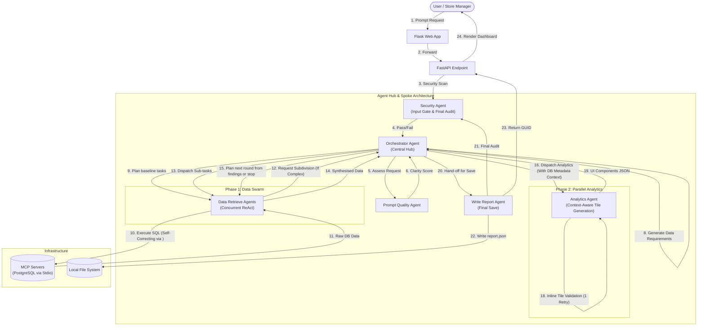

# Agentic Pipeline Architecture

## Overview

This folder contains specialised AI agents that form a **Hub-and-Spoke** multi-agent system, supercharged by **result-driven investigation rounds**, **Swarm Execution**, **LLM Self-Correction**, and **Recursive Task Subdivision**.

The **Security Agent** sits ABOVE the entire system as an overmind gatekeeper. It intercepts every prompt BEFORE the Orchestrator ever sees it. If the prompt is malicious or attempts privilege escalation, the Security Agent rejects it immediately.

The **Orchestrator Agent** is the central hub. The remaining agents (Quality, Data Retrieve, Analytics, Write Report) are spokes that the Orchestrator delegates to. Instead of relying on a dedicated external validation agent, this architecture pushes validation "to the edge" — relying on LLM-native Chain-of-Thought (the `<thought>` field) to self-correct SQL queries in-flight, inline validation functions for UI tiles, and a recursive task subdivision mechanism if a query proves too complex.

---

## 1. System Pipeline Diagram



---

## 2. Pattern Choice and Rationale

**Pattern Chosen:** Multi-Agent Hub and Spoke with Swarm execution, "Self-Correction at the Edge", and Recursive Task Subdivision.
**Rationale:** 
By placing the Orchestrator at the center (the Hub), we maintain strict control over the workflow. The data investigation proceeds in bounded rounds:
- **Result-Driven Investigation:** The Orchestrator first plans a baseline round, then sends the synthesized findings and completed tasks back to the planner. It selects focused follow-up analysis based on those findings, or stops when evidence is sufficient. The flow is capped at three rounds.
- **Planner Output Validation:** Plans are checked for the required JSON shape; one corrective retry is allowed for an invalid response, and a second invalid response fails explicitly.
- **Swarm Data Retrieval:** Independent Data Retrieve tasks within a round execute in parallel via native `asyncio.gather`; later rounds wait for and use the previous round's findings.
- **Self-Correction at the Edge:** Instead of relying on a dedicated Validation agent, the Data Retrieve Agent is forced to emit a `<thought>` key in its JSON before acting. This forces the LLM to inspect schema columns and pre-flight its SQL before execution.
- **Recursive Task Subdivision:** If a Data Retrieve agent struggles to write a valid query after 5 attempts, it actively returns a `request_subdivision` action. The Orchestrator will then break the complex task into 2-3 simpler sub-tasks and spawn a new swarm (up to a maximum depth of 2), preventing the pipeline from failing on difficult requests.
- **Context-Aware Analytics:** The Orchestrator passes DB Metadata (accessible stores via RLS) down to the Analytics agent. The Analytics agent uses this context to determine if the user is a local store manager or Head Office, adapting its text summaries and chart types accordingly.
- **Parallel UI Spooling:** The Analytics Agent spools parallel workers to build UI tiles concurrently. It employs fast, Python-level inline validation (`_validate_tile`) to catch null data or empty charts before they hit the final report.

---

## 3. File Inventory

| File                     | Agent                | Role                                              |
|--------------------------|----------------------|---------------------------------------------------|
| `llm_client.py`          | (shared)             | Azure OpenAI client used by all agents             |
| `config.py`              | (shared)             | Global constants (`MAX_REPORT_SECTIONS`, `SQL_VALIDATION_MAX_ITERATION`) |
| `security_agent.py`      | Security Agent       | Input gate + final file audit                      |
| `prompt_quality_agent.py`| Prompt Quality Agent | Prompt clarity check                               |
| `data_retrieve_agent.py` | Data Retrieve Agent  | MCP tool selection + ReAct loop database querying  |
| `analytics_agent.py`     | Analytics Agent      | Raw data → context-aware analytical summary + Tile Gen |
| `write_report_agent.py`  | Write Report Agent   | Generates title/summary, security audit, disk save |
| `orchestrator_agent.py`  | Orchestrator Agent   | Central hub — dispatches Swarms, manages subdivision |

---

## 4. Agent Responsibilities

1. **Security Agent**: Scans raw user input for malicious intent or RLS spoofing. Halts execution if failed. Also performs a final audit on the output.
2. **Orchestrator Agent**: The central hub. Generates the report outline, delegates tasks to the Swarm, handles recursive task subdivision for complex queries, coordinates the Analytics tile building, and manages final reporting.
3. **Prompt Quality Agent**: Evaluates if a user's prompt is clear enough to proceed.
4. **Data Retrieve Agent**: An autonomous Swarm agent using a ReAct loop (`SQL_VALIDATION_MAX_ITERATION`). Translates tasks into precise MCP tool calls, safely extracting and summarizing data from PostgreSQL. It acts as its own validator using Chain-of-Thought reasoning, and requests subdivision if a task is too complex.
5. **Analytics Agent**: Acts as the UI dashboard builder. Processes the raw data, transforms text into numeric arrays, intelligently selects Chart.js types, and uses RLS context to adapt its tone for single-store vs. head-office inquiries. Spawns up to 4 parallel workers.
6. **Write Report Agent**: Assembles the final `report.json` and `report_meta.json`. Executes the local write tool to disk.

---

## 5. Security Model

```
  ┌──────────────────────────────────────────────────────────┐
  │                  SECURITY LAYERS                         │
  │                                                          │
  │  Layer 1: Security Agent (Pre-Orchestration)             │
  │  ├── Catches prompt injection / jailbreaks               │
  │  ├── Catches privilege escalation                        │
  │  └── Rejects BEFORE any tokens are spent                 │
  │                                                          │
  │  Layer 2: Row Level Security (Database)                  │
  │  ├── RLS UUID passed from login → orchestrator → MCP     │
  │  ├── PostgreSQL enforces data boundaries                 │
  │  └── Store managers only see their own store's data      │
  │                                                          │
  │  Layer 3: Security Agent (Pre-Write Audit)               │
  │  ├── Validates file paths and metadata                   │
  │  └── Ensures report is saved to correct user directory   │
  └──────────────────────────────────────────────────────────┘
```

---

## 6. RLS UUID Flow

```
  Login Page                  Flask Session              Orchestrator
  ┌─────────┐   store_name   ┌───────────┐   user_id    ┌───────────┐
  │ Dropdown │──────────────►│ session   │─────────────►│ rls_user  │
  │ "Zava    │               │ ['user_id']│              │ _id =     │
  │ Retail   │               │ = UUID    │              │ user_id   │
  │ Seattle" │               └───────────┘              └─────┬─────┘
  │          │                                                │
  └─────────┘                                                 ▼
                                                    Data Retrieve Agent
                                                    ┌──────────────────┐
                                                    │ MCP call with    │
                                                    │ --RLS_USER_ID=   │
                                                    │ {rls_user_id}    │
                                                    └────────┬─────────┘
                                                             │
                                                             ▼
                                                    ┌──────────────────┐
                                                    │ PostgreSQL       │
                                                    │ SET app.current  │
                                                    │ _rls_user_id     │
                                                    │ = UUID           │
                                                    │                  │
                                                    │ RLS policies     │
                                                    │ filter all       │
                                                    │ SELECT queries   │
                                                    └──────────────────┘

  UUID Mapping (from reference_data.json):
  ┌──────────────────────┬──────────────────────────────────────────┐
  │ Store                │ RLS UUID                                 │
  ├──────────────────────┼──────────────────────────────────────────┤
  │ Headquarters (CEO)   │ 00000000-0000-0000-0000-000000000000     │
  │ Zava Retail Seattle  │ f47ac10b-58cc-4372-a567-0e02b2c3d479     │
  │ Zava Retail Bellevue │ 6ba7b810-9dad-11d1-80b4-00c04fd430c8     │
  │ Zava Retail Tacoma   │ a1b2c3d4-e5f6-7890-abcd-ef1234567890     │
  │ Zava Retail Spokane  │ d8e9f0a1-b2c3-4567-8901-234567890abc     │
  │ Zava Retail Everett  │ 3b9ac9fa-cd5e-4b92-a7f2-b8c1d0e9f2a3     │
  │ Zava Retail Redmond  │ e7f8a9b0-c1d2-3e4f-5678-90abcdef1234     │
  │ Zava Retail Kirkland │ 9c8b7a65-4321-fed0-9876-543210fedcba     │
  │ Zava Retail Online   │ 2f4e6d8c-1a3b-5c7e-9f0a-b2d4f6e8c0a2     │
  └──────────────────────┴──────────────────────────────────────────┘
```

---

## 7. LLM Configuration

All agents share `llm_client.py` which reads from the repository-root `.env`:

```
  AZURE_OPENAI_ENDPOINT=https://...
  AZURE_OPENAI_KEY=...
  GPT_MODEL_DEPLOYMENT_NAME=...
```

Each agent call is stateless — a fresh `call_llm(messages, json_mode)` invocation with its own system prompt. Agents do not share conversation history with each other, except inside a Swarm agent's active ReAct loop.
